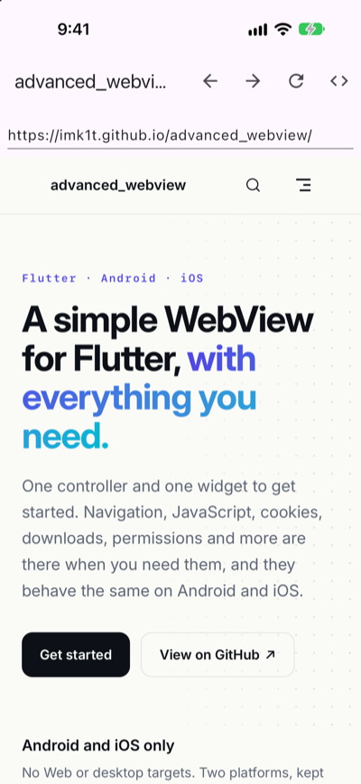
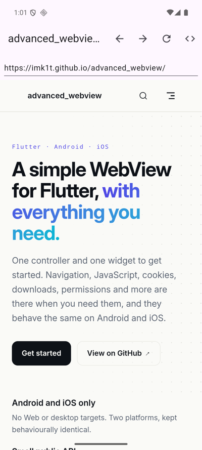

# advanced_webview

[English](README.md) | 日本語

[](https://pub.dev/packages/advanced_webview)
[](https://github.com/imk1t/advanced_webview/actions/workflows/ci.yaml)
[](LICENSE)

Android と iOS 向けの、シンプルで多機能な Flutter WebView プラグインです。型付きの Dart API ひとつで、両プラットフォームで同じように動きます。

`flutter_inappwebview` の機能設計を参考にしつつ、プラットフォーム契約を1か所に集約して保守性を優先しています。

ドキュメント: https://imk1t.github.io/advanced_webview/ja/

設計判断（Pigeon 採用理由など）は [ARCHITECTURE.md](ARCHITECTURE.md) を参照してください。

## スクリーンショット

[example アプリ](example)で `AdvancedWebView` を使い、ドキュメントサイトを表示している様子です（左: iOS、右: Android）。

<p>
  
  
</p>

## 対応プラットフォーム

| Android | iOS |
| --- | --- |
| API 24+ | iOS 18+ |

iOS は Swift Package Manager と CocoaPods の両方に対応しています。
Flutter の設定（`flutter config --enable-swift-package-manager` /
`--no-enable-swift-package-manager`）に応じてどちらでもビルドされ、プラグイン独自の手動リンク設定は不要です。アプリの要件は後述の手順に従って設定してください。

## インストール

[pub.dev](https://pub.dev/packages/advanced_webview) から追加します。

```sh
flutter pub add advanced_webview
```

最新の `main` を追う場合は Git 依存を使用してください。

```yaml
dependencies:
  advanced_webview:
    git:
      url: https://github.com/imk1t/advanced_webview.git
```

Flutter 3.47.8 以降（Dart 3.13.7 以降）が必要です。Android は実行時 API 24 以降、
ビルドには compileSdk 36 と JDK 17 が必要です。iOS は実行時とアプリの deployment target が 18.0 以降で、
ビルドには対応する iOS SDK を備えた Xcode が必要です。
Android アプリの `android/app/src/main/AndroidManifest.xml` の `<manifest>` 直下に追加します。

```xml
<uses-permission android:name="android.permission.INTERNET" />
```

詳細なプラットフォーム設定は[導入ガイド](https://imk1t.github.io/advanced_webview/ja/guide/getting-started)を参照してください。

## 使い方

```dart
import 'package:advanced_webview/advanced_webview.dart';

final controller = AdvancedWebViewController(
  javaScriptChannels: {'Bridge': (message) => print(message)},
  onPageFinished: (url) => print('loaded $url'),
  onNavigationRequest: (request) => request.url.startsWith('https://')
      ? NavigationDecision.navigate
      : NavigationDecision.prevent,
)..loadUrl('https://flutter.dev');

// build
AdvancedWebView(controller: controller);

// JS 実行（結果は JSON からデコード済み）
final title = await controller.runJavaScriptReturningResult('document.title');

// 不要になったら
await controller.dispose();
```

JS からは両OS共通で `window.Bridge.postMessage('hello')` を呼べます。

## 現在の機能

- URL / HTML 文字列の読み込み、リロード、停止、戻る・進む
- 現在の URL・タイトルの取得
- JavaScript の実行（戻り値あり／なし）
- JavaScript チャネル（JS → Dart のメッセージ）
- JavaScript ハンドラ（JS から Dart を呼び、戻り値を受け取る）
- ページからの権限リクエスト（カメラ、マイク、位置情報）
- ダウンロードの通知（ファイルの取得方法はアプリが決める）
- ツールバー付きの全画面アプリ内ブラウザ（`AdvancedInAppBrowser`）
- 証明書エラー、HTTP 認証、クライアント証明書（相互 TLS）のコールバック
- リクエストのインターセプト: カスタムスキーム（Android では `https` も）へのリクエストに Dart から応答
- 一時停止と再開（`pause`、`resume`、Android の `pauseTimers`）
- ズーム操作（`zoomBy`、`setZoomScale`）
- PDF の書き出し、ページ内検索のヒット数のライブ通知、ファビコン URL と全画面動画のコールバック
- コールバック: ページ開始・完了、進捗、タイトル変更、読み込みエラー
- 設定: JavaScript 有効化、User-Agent、メディア自動再生、インライン再生（iOS）、ズーム（Android）、背景透過

## 開発

Flutter は [mise](https://mise.jdx.dev) で管理しています（バージョンは `mise.toml` で固定）。

```sh
mise install                                         # 固定バージョンの Flutter を導入
flutter pub get
dart run pigeon --input pigeons/messages.dart   # pigeons/messages.dart を変更したとき
flutter analyze
flutter test                                     # Dart 単体テスト
cd example && flutter test integration_test      # 実機・シミュレータでの結合テスト
```

ネイティブコードは ktlint（Kotlin）と swift-format（Swift）で整形・検査しています。手順の詳細は [CONTRIBUTING.md](CONTRIBUTING.md) を参照してください。

## コントリビュート

Issue・Pull Request を歓迎します（日本語・英語どちらでも可）。[CONTRIBUTING.md](CONTRIBUTING.md) と [行動規範](CODE_OF_CONDUCT.md) を参照してください。
脆弱性の報告は Issue ではなく [SECURITY.md](SECURITY.md) の手順でお願いします。

AI コーディングエージェント向けの指示は [AGENTS.md](AGENTS.md) にあります（[APM](https://github.com/microsoft/apm) の `apm.yml` で配布）。

## ライセンス

[MIT License](LICENSE)
