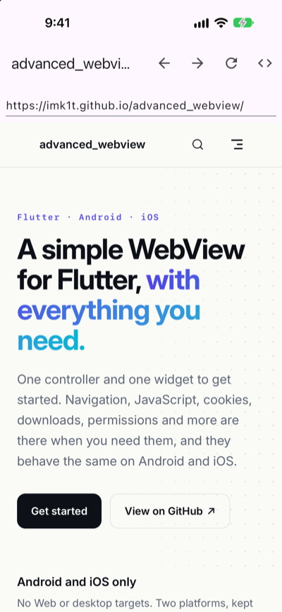
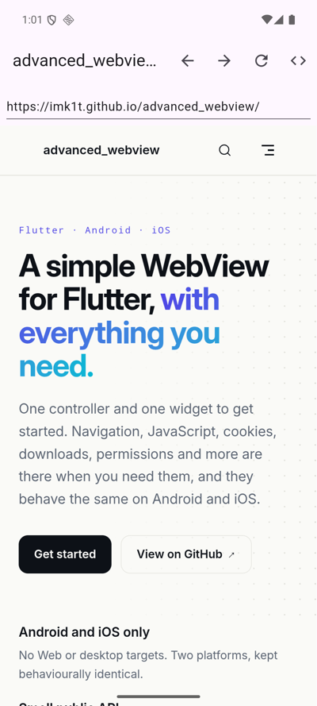

# advanced_webview

English | [日本語](README.ja.md)

[](https://pub.dev/packages/advanced_webview)
[](https://github.com/imk1t/advanced_webview/actions/workflows/ci.yaml)
[](LICENSE)

A simple yet feature-rich Flutter WebView plugin for Android and iOS. One typed Dart API that behaves the same on both platforms.

It borrows feature ideas from `flutter_inappwebview`, but favours maintainability with a
single, centralised platform contract.

Documentation: https://imk1t.github.io/advanced_webview/

For design decisions (such as why Pigeon was chosen), see
[ARCHITECTURE.md](ARCHITECTURE.md) (Japanese).

## Screenshots

The [example app](example) running `AdvancedWebView` on iOS (left) and Android (right), loading the documentation site.

<p>
  
  
</p>

## Supported platforms

| Android | iOS |
| --- | --- |
| API 24+ | iOS 18+ |

On iOS, both Swift Package Manager and CocoaPods are supported. The plugin builds with
either, depending on your Flutter setting (`flutter config --enable-swift-package-manager` /
`--no-enable-swift-package-manager`); no plugin-specific manual linking is needed. Configure your app requirements below.

## Installation

Install from [pub.dev](https://pub.dev/packages/advanced_webview):

```sh
flutter pub add advanced_webview
```

To track the latest `main` instead, use the Git dependency:

```yaml
dependencies:
  advanced_webview:
    git:
      url: https://github.com/imk1t/advanced_webview.git
```

Requires Flutter 3.47.8+ (Dart 3.13.7+). Android devices need API 24+; Android builds
need compileSdk 36 and JDK 17. iOS devices and the app deployment target must be
18.0+; builds need Xcode with an iOS SDK that supports that target.
Add this directly under `<manifest>` in your app's `android/app/src/main/AndroidManifest.xml`:

```xml
<uses-permission android:name="android.permission.INTERNET" />
```

See the [getting-started guide](https://imk1t.github.io/advanced_webview/guide/getting-started) for platform setup.

## Usage

```dart
import 'package:advanced_webview/advanced_webview.dart';

final controller = AdvancedWebViewController(
  javaScriptChannels: {'Bridge': (message) => print(message)},
  onPageFinished: (url) => print('loaded $url'),
  onNavigationRequest: (request) => request.url.startsWith('https://')
      ? NavigationDecision.navigate
      : NavigationDecision.prevent,
)..loadUrl('https://flutter.dev');

// build
AdvancedWebView(controller: controller);

// Run JavaScript (the result is already decoded from JSON)
final title = await controller.runJavaScriptReturningResult('document.title');

// When you no longer need it
await controller.dispose();
```

On both platforms, JavaScript can call `window.Bridge.postMessage('hello')`.

## Current features

- Load a URL or an HTML string; reload, stop, go back and forward
- Get the current URL and title
- Run JavaScript (with or without a return value)
- JavaScript channels (messages from JS to Dart)
- JavaScript handlers (JS calls Dart and gets a value back)
- Permission requests from pages (camera, microphone, location)
- Download notifications (the app decides how to fetch the file)
- Full-screen in-app browser with a toolbar (`AdvancedInAppBrowser`)
- Certificate error and HTTP authentication callbacks
- Navigation decisions (main frame)
- Request interception: answer custom-scheme requests (and, on Android, `https`) from Dart
- PDF export, live find-in-page match count, favicon URL and fullscreen video callbacks
- Callbacks: page started / finished, progress, title changed, load errors
- Settings: JavaScript enabled, User-Agent, media autoplay, inline playback (iOS),
  zoom (Android), transparent background

## Development

Flutter is managed with [mise](https://mise.jdx.dev) (the version is pinned in `mise.toml`).

```sh
mise install                                         # install the pinned Flutter
flutter pub get
dart run pigeon --input pigeons/messages.dart   # after editing pigeons/messages.dart
flutter analyze
flutter test                                     # Dart unit tests
cd example && flutter test integration_test      # integration tests on a device or simulator
```

Native code is formatted and linted with ktlint (Kotlin) and swift-format (Swift).
See [CONTRIBUTING.md](CONTRIBUTING.md) for the full workflow.

## Contributing

Issues and pull requests are welcome, in English or Japanese. Please read
[CONTRIBUTING.md](CONTRIBUTING.md) and the [Code of Conduct](CODE_OF_CONDUCT.md).
Please report security vulnerabilities by following [SECURITY.md](SECURITY.md), not
through public issues.

Instructions for AI coding agents are in [AGENTS.md](AGENTS.md) (shared skills are
distributed with [APM](https://github.com/microsoft/apm) via `apm.yml`).

## License

[MIT License](LICENSE)
